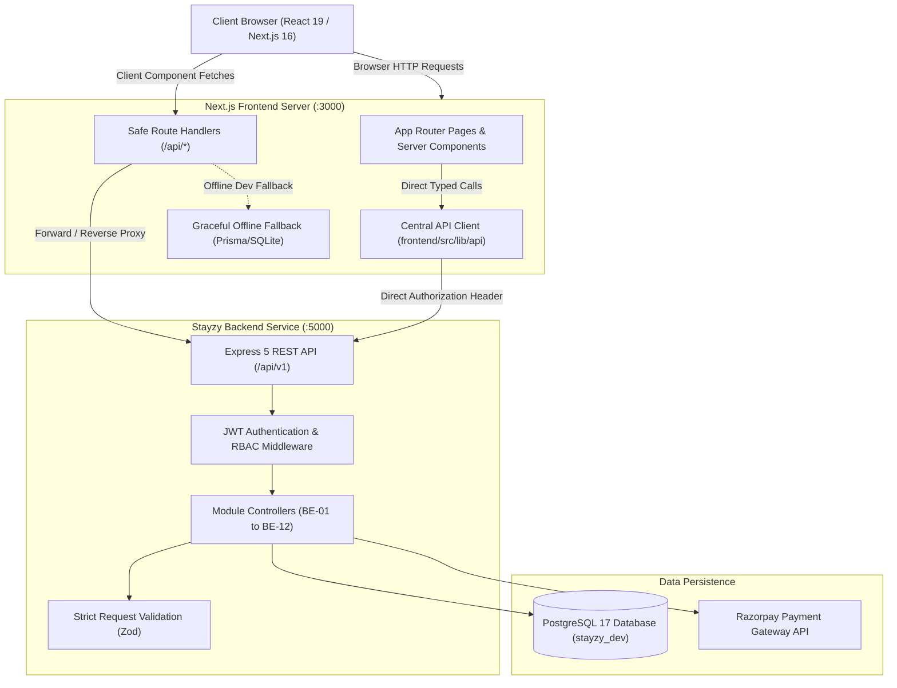
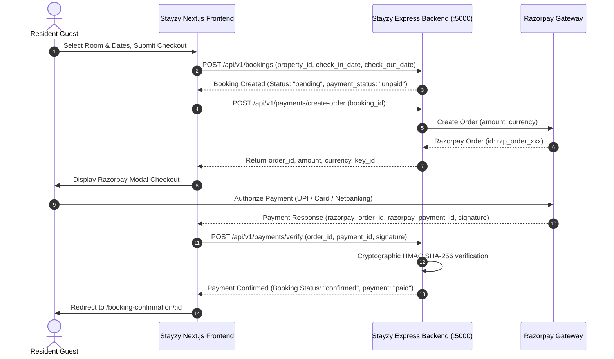

# Stayzy Frontend–Backend Integration Guide

## 1. Architecture Overview

Stayzy's production architecture decouples the high-performance Next.js 16 / React 19 presentation layer from the authoritative Express 5 / PostgreSQL 17 REST API service.



---

## 2. Directory Structure & Key Files

### Frontend Integration Layer (`frontend/src/lib/api/`)
- `client.ts`: Native fetch client with base URL resolution, JWT token attachment, and typed `ApiClientError` handling.
- `types.ts`: Comprehensive TypeScript interfaces for Users, Properties, Bookings, Payments, Reviews, and Admin statistics.
- `adapters.ts`: Bidirectional adaptors mapping backend entities to existing frontend UI contracts (`backendPropertyToFrontendRoom`, `backendBookingToFrontend`, `backendUserToFrontend`, and role mappers).
- `auth.ts`: Authentication methods (`login`, `register`, `getProfile`, `logout`, `getToken`).
- `users.ts`: User management client (`getMe`, `updateMe`, `listUsers`, `changeStatus`).
- `properties.ts`: Property catalogue, search, filters, and host listing management.
- `bookings.ts`: Booking creation, availability checks, cancellation, and status updates.
- `payments.ts`: Razorpay order creation, payment verification, failure capture, and refund requests.
- `reviews.ts`: Public property reviews, user reviews, and moderation.
- `admin.ts`: Platform KPI metrics, property moderation, booking oversight, and revenue reports.
- `index.ts`: Barrel export and default `stayzyApi` client.

---

## 3. Environment Variables Configuration

### Frontend (`frontend/.env`)
```bash
# Authoritative Express 5 Backend API URL
NEXT_PUBLIC_API_BASE_URL="http://localhost:5000/api/v1"
API_BASE_URL="http://localhost:5000/api/v1"

# Client Session Secret (for legacy cookie fallback)
AUTH_SECRET="stayzy_super_secret_jwt_key_2026_stay_flexible"
```

### Backend (`backend/.env`)
```bash
NODE_ENV=development
PORT=5000
API_PREFIX=/api/v1

# Security & Authentication (minimum 32 characters)
JWT_SECRET="stayzy_super_secret_jwt_key_2026_stay_flexible_integration"
JWT_EXPIRES_IN=1d

# CORS Allowed Origin
CORS_ORIGIN=http://localhost:3000

# PostgreSQL Database Configuration
DB_HOST=localhost
DB_PORT=5432
DB_NAME=stayzy_dev
DB_USER=postgres
DB_PASSWORD=postgres
DB_POOL_MAX=10
DB_IDLE_TIMEOUT_MS=30000
DB_CONNECTION_TIMEOUT_MS=5000

# Razorpay Payment Gateway (Test credentials)
RAZORPAY_KEY_ID=rzp_test_stayzykey123
RAZORPAY_KEY_SECRET=rzp_test_secret_stayzy456
RAZORPAY_WEBHOOK_SECRET=rzp_webhook_secret_stayzy789
```

---

## 4. Setup & Running Instructions

### Prerequisites
- Node.js 18+ (tested on Node 20 / 22)
- PostgreSQL 17 (or local Docker container `docker run -p 5432:5432 -e POSTGRES_PASSWORD=postgres -e POSTGRES_DB=stayzy_dev postgres:17`)

### 1. Start the Express Backend
```bash
cd backend
npm install
npm test tests/config.test.js
npm run dev
# Server starts at http://localhost:5000 (Swagger UI at http://localhost:5000/api/docs)
```

### 2. Start the Next.js Frontend
```bash
cd frontend
npm install
npm run dev
# Application starts at http://localhost:3000
```

---

## 5. API Mapping Reference

| Frontend Feature | Client Handler / Route | Backend Express Route | Methods | Auth Required |
| :--- | :--- | :--- | :--- | :--- |
| **User Registration** | `authApi.register` / `/api/auth/register` | `/api/v1/auth/register` | POST | No |
| **User Login** | `authApi.login` / `/api/auth/login` | `/api/v1/auth/login` | POST | No |
| **Current User Check** | `authApi.getProfile` / `/api/auth/me` | `/api/v1/auth/me` | GET | Yes (JWT) |
| **User Profile Update** | `usersApi.updateMe` / `/api/auth/profile` | `/api/v1/users/me` | PATCH | Yes (JWT) |
| **Property Catalogue** | `propertiesApi.listProperties` / `/api/rooms` | `/api/v1/properties` | GET | No |
| **Property Search & Filter** | `propertiesApi.searchProperties` / `/api/rooms` | `/api/v1/properties/search` | GET | No |
| **Single Property Details** | `propertiesApi.getPropertyById` / `/api/rooms/[slug]` | `/api/v1/properties/:id` | GET | No |
| **Host Listings** | `propertiesApi.getMyListings` | `/api/v1/properties/my-listings` | GET | Yes (Host/Admin) |
| **Create Property** | `propertiesApi.createProperty` / `/api/admin/properties` | `/api/v1/properties` | POST | Yes (Host/Admin) |
| **Check Date Availability**| `bookingsApi.checkAvailability` | `/api/v1/bookings/availability` | GET | No |
| **Create Booking** | `bookingsApi.createBooking` / `/api/checkout/create-booking`| `/api/v1/bookings` | POST | Yes (Guest) |
| **User Booking History** | `bookingsApi.getMyBookings` / `/api/bookings/my` | `/api/v1/bookings` | GET | Yes (Guest) |
| **Cancel Booking** | `bookingsApi.cancelBooking` / `/api/bookings/[id]/cancel` | `/api/v1/bookings/:id/cancel`| PATCH | Yes (Guest/Admin) |
| **Create Payment Order** | `paymentsApi.createOrder` / `/api/payments/create-order` | `/api/v1/payments/create-order` | POST | Yes (Guest) |
| **Verify Payment Signature**| `paymentsApi.verifyPayment` / `/api/payments/verify` | `/api/v1/payments/verify` | POST | Yes (Guest) |
| **Record Payment Failure** | `paymentsApi.recordFailure` / `/api/payments/fail` | `/api/v1/payments/fail` | POST | Yes (Guest) |
| **Property Reviews** | `reviewsApi.getPropertyReviews` | `/api/v1/reviews/property/:propertyId` | GET | No |
| **Submit Review** | `reviewsApi.createReview` | `/api/v1/reviews` | POST | Yes (Guest) |
| **Admin Dashboard Stats** | `adminApi.getDashboardStats` / `/api/admin/stats` | `/api/v1/admin/dashboard` | GET | Yes (Admin) |
| **Admin Moderate Property**| `adminApi.moderateProperty` | `/api/v1/admin/properties/:id/status` | PATCH | Yes (Admin) |
| **Admin Booking Oversight**| `adminApi.getBookings` / `/api/admin/bookings` | `/api/v1/admin/bookings` | GET | Yes (Admin) |
| **Revenue Report** | `adminApi.getRevenueReport` | `/api/v1/admin/reports/revenue` | GET | Yes (Admin) |

---

## 6. Authentication & Role-Based Access Control (RBAC)

1. **JWT Issuance**:
   Upon successful credentials authentication at `/api/v1/auth/login`, the Express backend generates a signed JWT signed with `JWT_SECRET`.
2. **Cookie Handling**:
   The frontend sets the `stayzy_jwt_token` cookie (and backwards-compatible `stayzy_session_token`) with `httpOnly: true`, `path: '/'`, `sameSite: 'lax'`.
3. **Authorization Header**:
   The `apiClient` automatically reads the token from cookies or localStorage and attaches `Authorization: Bearer <token>` to all HTTP mutations and protected queries.
4. **Role Harmonization**:
   - Backend `guest` <-> Frontend `CUSTOMER`
   - Backend `host` <-> Frontend `OWNER`
   - Backend `admin` <-> Frontend `ADMIN`
5. **Production Persona Switcher**:
   In production (`process.env.NODE_ENV === "production"`), the demo persona switcher `/api/auth/switch` is strictly disabled with HTTP 403 Forbidden, forcing authentic authentication through `/login` and `/register`.

---

## 7. Razorpay Payment Workflow



---

## 8. Graceful Fallback & Zero-Breaking Resilience

- All Next.js API routes under `frontend/src/app/api/` retain full backwards compatibility with existing UI components.
- When the Express backend is active and PostgreSQL is running, queries and mutations are routed to the authoritative service.
- If the Express service is offline during local UI development or static SSG compilation, Next.js routes fall back cleanly to local SQLite Prisma queries without throwing 500 runtime errors.
- SQLite `dev.db` databases and Prisma schemas remain completely intact.

